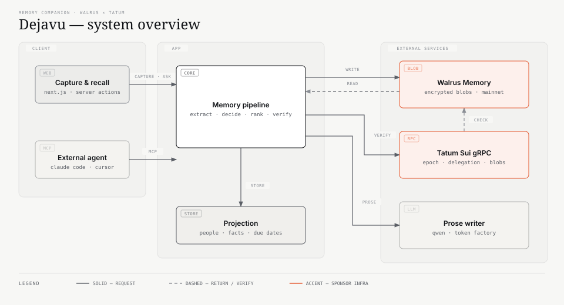
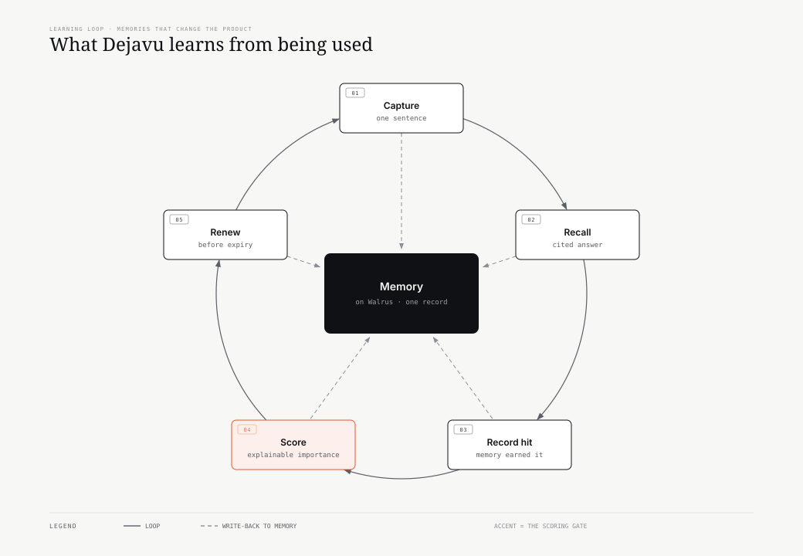

# Dejavu — a memory companion that actually remembers

**Dejavu is a memory companion for everything you'd otherwise forget** — a person
you met, a promise you made, an idea, a deadline, a receipt, a plan. Write one
sentence in plain words; Dejavu extracts the structure, stores it as an
**encrypted blob on Walrus**, and later answers questions from the exact
memories it saved — with citations, verified against their sources.

Built for **Walrus × Tatum: Total Recall** (Track: *Smart Agents for Real Life*).

> **Live app:** https://dejavu-memory.fly.dev
> **Proof:** `GET /api/health` · **Code:** [github.com/PhiBao/dejavu](https://github.com/PhiBao/dejavu), MIT

---

## Product

### What it is

A single capture box and a single question box. Capture accepts anything
worth remembering — people, notes, promises, ideas, deadlines — and turns it
into structured memory stored on Walrus. Dejavu answers in natural language
from those memories, cites them, and keeps a **Today** feed of follow-ups so
promises don't quietly rot.

### Who it is for

People whose life doesn't fit in a form: founders, salespeople, recruiters,
consultants, community builders — and anyone who keeps a running note file
because their brain is full. The first-class case is **people** (where
forgetting costs the most); the product is deliberately not limited to them.

### The problem

- **Notes don't answer questions.** A note app stores text; it cannot tell you
  *"who was hiring React engineers?"* or *"when does my passport expire?"*
- **CRMs demand data entry nobody sustains.** Structure is valuable; forms are not.
- **Chatbots forget.** Context dies with the session, the tab, or the vendor.
- **Cloud memory is rented memory.** Your context is trapped in one product's
  database, in one product's format, with no proof it still exists.

### Value proposition

1. **One sentence in, cited answers out.** No schemas, no pipeline stages, no admin panel.
2. **The memory is yours, portable and verifiable.** It lives on Walrus as
   encrypted blobs, readable by any client with the right key — including an
   agent using Walrus Memory's own MCP tools. Delete the app's index and it
   still answers.
3. **It doesn't make things up.** Answers are grounded in retrieved memories,
   every shown citation is machine-checked, and unknown questions abstain
   before spending a generation call.
4. **It tells you what it's about to forget.** Storage lifetime is read from
   Sui (via Tatum), not assumed, and surfaced before expiry.

### Why now

Three things became cheap at the same time: capable open-weight models
(Qwen via Token Factory), semantic memory as infrastructure (Walrus Memory),
and independent onchain reads (Tatum gRPC). A solo builder can now ship a
memory product whose durability is **verifiable by a third party** instead of
promised in a privacy policy.

### Key product insight

**The writer is replaceable; the memory is not.** Models will change, keys will
expire, providers will disappear. So Dejavu puts the durable thing (memory) on
Walrus, the decision layer in calibrated judgments, and treats the LLM as a
swappable prose renderer — with the active writer shown on every answer.

---

## User Experience

### Primary workflow

```
write one sentence  →  structure extracted  →  encrypted blob on Walrus
        ↓                                             ↓
  follow-up lands in Today                   ask anything, in your own words
                                                      ↓
                                        cited answer + verified sources
```

### Activation moment

The first time a question is asked in **different words** than the note and
still returns the right memory — *"who's recruiting frontend people?"* →
Sarah Chen, with the source cited. That's when it stops feeling like a notes
app and starts feeling like memory.

### Important interactions

| Interaction | What happens |
|---|---|
| **Remember** | Extracts person (if any), facts, and follow-ups; writes one encrypted Walrus blob; shows who resolved the person and whether the blob is certified. |
| **Dejavu** | Semantic search over your namespace → calibrated ranking → grounded synthesis → citation verification. Abstains when nothing is relevant. |
| **Today** | Due/overdue follow-ups with a pre-drafted message. Done / Snooze / Dismiss. |
| **Memory Health** | What Dejavu learned about which memories you actually rely on, and what the chain says about their storage window. |
| **Verified onchain** | Independent Tatum Sui gRPC check: blob objects, agent delegation, Walrus epoch, real expiry. |
| **MCP** | Any agent can read your memory — via Dejavu's scoped server, or Walrus Memory's native tools. |

### Differentiation

| | Note apps | CRMs | Chatbots w/ memory | **Dejavu** |
|---|---|---|---|---|
| Capture effort | low | high | low | **one sentence** |
| Answers questions | ✗ | partial | ✓ | **✓ cited** |
| Structure extracted | ✗ | ✓ (manual) | ✗ | **✓ automatic** |
| Memory portable across apps | ✗ | ✗ | ✗ | **✓ Walrus blobs** |
| Independent proof it exists | ✗ | ✗ | ✗ | **✓ Sui gRPC via Tatum** |
| Proactive follow-up | ✗ | partial | ✗ | **✓ Today feed** |

---

## Innovation

### What is genuinely novel

1. **Answers that are verified, not just grounded.** Every citation is checked
   by a calibrated judgment against its source; contradicted sources are
   hidden, and if all fail the answer is withheld. Most RAG demos stop at
   "here are some chunks".
2. **Abstention as a feature.** A relevance judgment gates synthesis, so
   unknown questions cost nothing and return an honest "I don't have a memory
   of that yet" with zero citations.
3. **A learning loop tied to storage economics.** Dejavu records which memories
   are actually recalled, scores importance with an explainable formula
   (reliance · recency · relationship · obligation), uses it as a ranking
   tie-break, and pairs it with onchain expiry to say *which memories are worth
   renewing first*.
4. **Memory verified by a second provider.** Walrus Memory says the blob exists;
   Tatum's Sui gRPC proves it — the `Blob` object, its certification epoch, its
   storage window, and that our delegate key is registered on the account.

### What technology enables it

- **Walrus Memory** — encrypted, content-addressed blobs with semantic recall
  and per-user namespaces. Without it, portability would be a migration script.
- **Tatum Sui gRPC** — independent reads of Walrus system state, the MemWal
  account, and every `Blob` object. Without it, durability would be a claim.
- **TypeSafe Jev** — calibrated, typed judgments (choice / score / noul) for
  identity, relevance, and citation verdicts. Without it, "confidence" would be
  a vibe.
- **Open-weight models (Qwen via Nebius Token Factory)** — cheap, structured
  prose generation with a provider chain so no single key can break the product.

### Why it is not a thin wrapper

The wrapper is ~200 lines. Dejavu is ~4,000: a domain model (people, facts,
commitments, usage), a capture pipeline with grounding gates, a four-stage
recall pipeline, calibrated judgments with fallbacks, an onchain verification
layer with caching and a credit budget, per-user isolation, an MCP server,
durability and e2e verifiers, and 82 tests. The hard parts are the failure
modes — and they're documented and tested.

---

## Hackathon Relevance

### Selected track

**Smart Agents for Real Life** — agents that pick up where they left off across
tools and sessions. Dejavu is exactly that: a companion whose context survives
the session, the app, and the model.

### Sponsor technology, meaningfully integrated

| Sponsor tech | Where it does real work |
|---|---|
| **Walrus Memory** | Every capture is one encrypted blob in a per-user namespace on **mainnet**. Dejavu searches it semantically, cites blob ids, and can rebuild its index from Walrus alone (`restore()`). Agents read the same blobs via Walrus Memory's native MCP. |
| **Tatum Sui gRPC** | Reads the Walrus system state (epoch, capacity, prices), the MemWalAccount (owner, active flag, delegate keys — verifying our agent's key is registered onchain), and every Walrus `Blob` object (certification epoch, storage window, size). This is the product's independent proof layer and the source of the expiry shown in the UI. |

Not decorative: if Tatum is unavailable, the app says so and keeps working; if
Walrus is unavailable, capture is preserved locally and the UI says the write
is queued.

### Judging criteria mapping

| Criterion | Weight | Where it's addressed |
|---|---|---|
| Walrus & Tatum integration | 30% | One blob per capture in per-user namespaces; semantic recall with citations; `restore()` durability; native MCP portability. Tatum verifies every blob, the account's delegation, and the real storage window. |
| Technical quality | 30% | Typed judgments with fallbacks, grounding gates, citation verification, 82 tests, 28-check e2e verifier, durability verifier, Tatum verifier, credit budget, per-user isolation. |
| Creativity | 20% | Cited + machine-verified memory, calibrated abstention, an explainable importance loop tied to storage renewal. |
| Presentation | 20% | Live app, one-click demo story, `/api/health` proof surface, this README, demo video. |

---

## Architecture

### System overview



The app owns **decisions** and **structure**; Walrus owns the **memory**; Tatum
provides an **independent** read of what actually exists onchain. No component
is decorative — remove Tatum and the "verified" claim disappears; remove Walrus
and there is no durable memory left.

### Capture and recall flow

**Capture** — one sentence in:

1. The writer extracts structure while Jev resolves identity, in parallel.
2. Headline, company and every fact value are **grounded** against the note;
   anything not evidenced is dropped.
3. The enriched record is written to Walrus Memory as one encrypted blob in the
   user's namespace; the returned blob id lands on the projection row.
4. Tatum reads the resulting `Blob` object back and records its storage window.

**Recall** — a question in your own words:

1. `memwal.recall()` returns a semantic shortlist from the namespace.
2. Jev scores each candidate (calibrated 0–1); the learning loop adds a small
   reliance tie-break for memories you have actually used.
3. If nothing clears the threshold, Dejavu **abstains before synthesis** — no
   generated answer, no citations, no cost.
4. Otherwise the writer synthesizes only from the shortlist, and Jev verifies
   every citation against its source. Contradicted sources are hidden; if all
   fail, the answer is withheld.

### Learning loop



Every recall records which memory earned it. Importance is explainable —
reliance (0.45), recency (0.20), relationship (0.20), obligation (0.15) — and
feeds two visible behaviours: a capped ranking tie-break, and a renewal
priority against the onchain expiry. The loop is how memory *changes the
product* rather than merely persisting.

### Major components

| Path | Responsibility |
|---|---|
| `lib/memory.ts` | Domain pipeline: `captureMemory()` and `recall()` — grounding, ranking, synthesis, verification. |
| `lib/memwal.ts` | Walrus Memory client, per-user namespaces, blob URLs, durability helpers. |
| `lib/tatum.ts` | Sui gRPC: Walrus system state, MemWal account + delegate check, blob index, expiry math, credit budget. |
| `lib/judge.ts` | Calibrated judgments: intent routing, person resolution, relevance, citation verification. |
| `lib/ai.ts` | Prose writer with provider chain and attribution; extraction schema. |
| `lib/health.ts` | Learning loop: usage → explainable importance → ranking boost + renewal priority. |
| `lib/store.ts` | Local projection (people, facts, commitments, users, keys, usage, audit). |
| `app/api/mcp` | Read-only MCP server scoped to the user's API key. |
| `app/api/health` | Proof surface: Walrus, Tatum onchain verification, writer status, counts. |

### Data flow and boundaries

- **Browser → server actions only.** Every write goes through a server action that
  resolves the authenticated user first; there is no client-side database access.
- **Server → Walrus Memory.** One operator MemWalAccount pays for storage; each
  app user gets a deterministic namespace (`recall-<userId>`). The delegate key
  never leaves the server.
- **Server → Tatum.** Read-only JSON-RPC, paced and cached, used for verification
  and expiry. Never used to write.
- **Server → writer.** OpenAI-compatible chat completions; the model only writes
  prose from decided context.
- **Projection is disposable.** It carries structure for the UI, not memory
  content. Losing it degrades the product but never loses a memory.

### Important technical decisions

| Decision | Why |
|---|---|
| One blob per capture (raw text + structure together) | A recall returns a coherent record with a citation, not five fragments. `analyze()` was measured and rejected for this reason. |
| Grounding gates on headline, company and fact values | A fact the user never wrote is worse than a missing fact. Invented titles were observed and fixed. |
| Abstain before synthesis | Saves cost and prevents confident nonsense on unknown questions. |
| Verify citations, hide contradicted ones | Trust is the product. A contradicted source means the synthesis drifted. |
| Provider chain for prose | Hosted keys expire; a demo must never silently answer from a regex. |
| Onchain verification cached + budgeted | Independent proof without burning the free tier (3 RPS, 100K credits). |

### External services

| Service | Role | Failure behavior |
|---|---|---|
| Walrus Memory (mainnet) | Durable encrypted memory | Capture saved locally, write queued; recall falls back to the local projection |
| Tatum Sui gRPC | Independent verification, expiry | Panel reports "unavailable"; app keeps working on the relayer's word |
| Nebius Token Factory (Qwen) | Prose writer | Falls through the provider chain; UI shows the writer that answered |
| TypeSafe Jev | Decisions | Falls back to generative ranking / writer's proposal |
| Fly.io | Hosting + persistent volume | Single instance; volume holds the projection |

---

## Running

### Prerequisites

- Node ≥ 20 (tested on 22), `pnpm`
- A **Walrus Memory** account — [memory.walrus.xyz](https://memory.walrus.xyz)
- Optional: a **Tatum** API key (free plan) for onchain verification
- Optional: an OpenAI-compatible writer key (Nebius Token Factory, OpenRouter, …)

### Installation

```bash
pnpm install
cp .env.example .env.local
pnpm store:init        # create the local projection file
pnpm memwal:verify     # prove the Walrus round-trip
pnpm dev               # http://localhost:3000
```

### Environment variables

| Variable | Required | Purpose |
|---|---|---|
| `AUTH_SECRET` | yes | Session signing (≥16 chars) |
| `MEMWAL_PRIVATE_KEY` | yes | Walrus Memory delegate key (server-only) |
| `MEMWAL_ACCOUNT_ID` | yes | MemWalAccount object id on Sui |
| `MEMWAL_SERVER_URL` | no | Relayer URL (defaults to mainnet) |
| `TATUM_API_KEY` | recommended | Onchain verification via Sui gRPC |
| `TATUM_SUI_GRPC_URL` | no | Defaults to `https://sui-mainnet-grpc.gateway.tatum.io` |
| `TOKENFACTORY_API_KEY` | recommended | Primary prose writer (Qwen) |
| `TOKENFACTORY_MODEL` | no | Defaults to `Qwen/Qwen3-30B-A3B-Instruct-2507` |
| `TYPESAFE_API_KEY` | recommended | Calibrated judgments |
| `AI_PROVIDER` | no | `mock` for a fully offline demo |
| `DEJAVU_DATA_PATH` | no | Projection path (defaults to `./data/recall.json`) |

Every key is optional in the sense that the app degrades gracefully — but the
degradation is **visible**, never silent.

### Development commands

```bash
pnpm dev            # dev server
pnpm typecheck      # strict TypeScript
pnpm test           # 82 unit tests (hermetic, no network)
pnpm lint           # eslint
```

### Test and verification commands

```bash
pnpm test              # unit tests
pnpm verify:e2e        # 28 checks over the real product path (live Walrus)
pnpm memwal:verify     # Walrus round-trip: health → blob → recall
pnpm memwal:durability # blobs owned onchain; recall survives losing the index
pnpm memwal:analyze    # measured comparison: analyze() vs our extraction
pnpm judge:verify      # judgments live: route, resolve, rank, verify citations
pnpm tatum:verify      # onchain: system state, delegation, blobs, expiry
pnpm mcp:verify        # MCP server with a user API key
pnpm verify            # typecheck + tests + e2e + durability
```

### Production build

```bash
pnpm build && pnpm start
fly deploy --ha=false    # Fly.io: 256MB machine + 1GB volume
```

---

## Demo

### Deployed application

**https://dejavu-memory.fly.dev**

### Required setup

None. Sign in with any email (passwordless, instant private namespace), then
press **"Load the demo story"** — eight realistic memories go through the real
pipeline and become eight genuine Walrus mainnet blobs.

### Demo flow (~90 seconds)

1. **Load the demo story.** Watch the confirmations: person resolved, facts
   extracted, follow-up added, blob certified.
2. **Ask in different words:** *"Who did I meet that's recruiting frontend
   people?"* → Sarah Chen, cited, scored, ✓ verified.
3. **Ask something unknown:** *"Who do I know in Tokyo who plays chess?"* →
   an honest "I don't have a memory of that yet", zero citations.
4. **Open the ⬡ chip** next to a memory — that's the encrypted blob on the
   public aggregator. Anyone can fetch it; only the owner can read it.
5. **Check "Verified onchain"** — Walrus epoch, agent authorization, blob count,
   and the real storage expiry read through Tatum.
6. **Check "Memory health"** — which memories you actually rely on, and which
   would be worth renewing first.

### What a judge should try first

Ask a question the note doesn't literally answer. The gap between "semantic
recall" and "keyword search" is the product.

---

## Verification

Honest status of every claim in this README.

| Capability | Status | How to verify |
|---|---|---|
| Capture → Walrus mainnet blob | **Real, live, onchain** | ⬡ chip; `pnpm memwal:verify`; `GET /api/health` |
| Semantic recall across sessions | **Real, live** | Ask in different words; citations show blob ids |
| Citations verified against sources | **Real, live** | ✓ badges; `pnpm judge:verify` |
| Abstention on unknown questions | **Real, live** | Ask about Tokyo chess |
| Per-user namespace isolation | **Real** | `pnpm verify:e2e` (isolation section) |
| Agent reads the same blobs | **Real** | Native Walrus MCP; `docs/ops-agent.md` |
| Durability: recall without local index | **Real** | `pnpm memwal:durability` |
| Onchain verification (Tatum) | **Real, live, externally verifiable** | `pnpm tatum:verify`; Sui explorer link in UI |
| Agent delegation onchain | **Real, live** | Delegate key shown as registered on the MemWalAccount |
| Storage expiry | **Real, onchain** | `end_epoch` 55 → 2027-05-04 (196 days at time of writing) |
| Learning loop (importance, ranking) | **Real** | Memory Health panel; `tests/health.test.ts` |
| Prose writer | **Real**, with a visible fallback chain | "written by …" on every answer; `/api/health` |
| Demo data | **Real captures** | "Load the demo story" runs the real pipeline |
| `AI_PROVIDER=mock` mode | **Simulated** | Dev-only deterministic extractor/embedder; never presented as the real path |
| Multi-turn conversation context | **Not implemented** | Each recall is independent (see Limitations) |
| Email ownership verification | **Not implemented** | Passwordless sign-in issues a session directly |

The UI never claims more than the system can prove: a capture says *certified*,
*certifying*, or *write queued*; an answer names the model that wrote it; an
onchain panel says *unavailable* rather than pretending.

---

## Security and Reliability

### Permission model

- **Per-user isolation** is enforced server-side: every query is scoped by the
  authenticated `user_id`; the browser never talks to Walrus or Tatum directly.
- **Namespaces are an application boundary, not a cryptographic one.** The
  operator's delegate key can read every namespace under the account. Isolation
  depends on the server mapping an authenticated session to the correct
  namespace — stated plainly because it matters.
- **API keys** (for MCP) are stored as SHA-256 hashes with a display prefix; the
  raw key is shown once. Read-only and scoped to one user.
- **Sessions** are signed HS256 JWTs in `httpOnly`, `sameSite=lax`, `secure`
  cookies.

### Sensitive flows

| Flow | Protection |
|---|---|
| Sign-in | Signed session cookie; email ownership verification is stubbed (known gap) |
| Capture | Zod-validated, length-capped, rate-limited (30/min/user) |
| Dejavu | Rate-limited; synthesis constrained to retrieved memories |
| MCP | Bearer key → hash lookup → user-scoped tools only |
| Onchain reads | Read-only RPC, server-side key, paced and cached |

### Failure handling

- **Walrus unreachable:** capture is kept locally and the UI says the write is
  queued; recall falls back to the local projection.
- **Writer down:** provider chain falls through; every answer shows the model
  that answered; `/api/health` reports `degraded`.
- **Tatum down / budget spent:** onchain panel reports unavailable and serves
  the last known values; the product keeps working.
- **Jev down:** falls back to generative ranking and the writer's proposal.
- **Rate limits:** relayer writes retry once with backoff; Tatum requests are
  serialized, cached, and capped at 120/hour.

### Known risks

- **Prompt injection via stored content.** A memory could contain text that
  tries to steer synthesis. Mitigations: synthesis is grounded, citations are
  verified, and contradicted sources are hidden — but a memory is still
  untrusted input and should be treated as data, not instructions.
- **Projection is unencrypted at rest.** Walrus blobs are Seal-encrypted; the
  local projection (names, facts) is not. It lives on an encrypted Fly volume.
- **Single instance.** The projection is a JSON file on one machine; horizontal
  scaling needs a shared store.
- **Delegate key compromise** grants read access to every namespace under the
  account. Rotation is a dashboard operation, not automated here.

---

## Limitations and Roadmap

### Current limitations

- **Text only.** No images, voice, or file ingestion.
- **No multi-turn conversation.** Dejavu answers each question independently;
  the thread in the UI is display-only.
- **No edit or delete UI.** Memories are append-only; Walrus blobs are immutable
  by design, so deletion needs an explicit product decision.
- **Storage lifetime is ~196 days** at the relayer's current 15-epoch purchase.
  Expiry is surfaced, but renewal is manual.
- **Free-tier constraints.** Tatum: 3 RPS, 100K credits, no batch JSON-RPC.
- **Email sign-in is not verified.** Documented, not accidental.
- **Demo-focused auth.** One operator MemWalAccount; multi-tenant accounts per
  user would be the production shape.

### Naming note (why one identifier still says `recall`)

The product is **Dejavu**. The Walrus namespace prefix remains
`recall-<userId>` on purpose: recall is scoped by exact namespace, so renaming
it would orphan every blob already written to mainnet. It is an implementation
detail — the product, UI, MCP server, API keys, domain and docs are Dejavu.

### Known tradeoffs

| Tradeoff | Choice | Cost |
|---|---|---|
| One blob per capture | Coherent records, one citation per memory | Coarser granularity than per-fact blobs |
| Local JSON projection | Zero infrastructure, one-command run | Not horizontally scalable |
| Calibrated judgments on every recall | Trust and abstention | ~2 extra model calls per question |
| Onchain verification on render | Independent proof | RPC budget; mitigated by caching |

### Next steps

1. **Multi-turn recall** — carry conversation context into retrieval.
2. **Note-first surfaces** — a note detail view, tags, and search filters, so
   non-person memories feel as first-class as people do.
3. **Renewal flow** — one-click extend for memories the health loop marks as
   important, before their storage window closes.
4. **Per-user Walrus accounts** — users own their MemWalAccount, not just a
   namespace.
5. **Verified sign-in** — magic link or Sui wallet signature.
6. **Export and delete** — data rights for an append-only store (tombstones +
   key destruction).

### Future product direction

Memory as infrastructure: the same namespace readable by every agent a person
uses, owned by the person, with the app as one client among many. Dejavu's job
is to make capture effortless and recall trustworthy — not to be the place your
memory dies.
